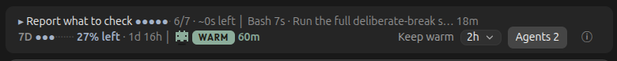

# Emberline

**A live ribbon for Claude Code. See what your session is doing, what it costs, and keep its context warm while you are away.**



Claude's prompt cache expires an hour after the last request. Come back later and the next message rewrites the whole conversation at full price, or the app swaps your context for a summary. Emberline shows you that clock, and can hold it open for you.

## What it shows

**The ribbon**
- Each usage limit as a tick bar that fills as you use it, beside what's left and when it resets. When the pace of the last hour would use a limit up before it resets, an amber `out in ~2h 30m` says when.
- Context tokens and share of the window, always shown, with a small colour bar of what fills it when the row has room.
- Cache WARM or COLD, with a countdown and the share of the last request the cache really served. While keep-warm holds, the countdown shows its time left instead (`ember 1h 50m`).
- The session's running cost at list price, when the row has room.

**The upper row**
- The current step of the task list, a step count and a rough time left.
- Running subagents, connector calls and shell commands past 5 seconds.
- Background work, added when a turn ends.

**Behind `ⓘ`**
- Each context category with its tokens and share, counted locally with no API call.
- Idle time, tokens in cache, and what the next message costs on each model, your own at its exact version. A version the price table does not list yet shows its family's current price marked `~` here, and no price on the ribbon.
- The cache hit of the last 20 requests as a strip of bars, a hit under 50% in amber.
- While keep-warm holds, its time left and about when the cache will go cold.
- After the first ping, this session's tally: pings, what they cost, what a re-cache would cost, and the last ping's time and tokens read.

**On request**
- An Agents button once any subagent has run (dimmed when none is running), and a panel (`/agents-panel`, or `Agents panel` behind `ⓘ` before any has run) with each subagent's model, time, tokens and estimated cost. `/clear` empties both.
- A notification before the cache goes cold, for sessions over 100k tokens: 10 minutes ahead by default, 5, or off (`warnMinutes`). With keep-warm off it weighs the two: what the re-cache will cost, and about what 2h of keep-warm from there would.

Set options with `Warn` and `Auto` behind `ⓘ`, with `/plugin configure emberline@claude-ribbon-emberline` at the prompt, or pipe a JSON object to `claude plugin configure emberline@claude-ribbon-emberline --values-stdin`.

## Keep-warm

Pick 1h, 2h, 6h or 12h from the `Ember` picker on the ribbon, or run `/keep-warm 1h` to `12h`, `off` or `ping`. The picker also offers `Until` the next three full hours at least an hour away, and `Custom…`, which asks for any length or time the command takes. `/keep-warm until 18:30` takes any clock time within 12 hours: keep-warm holds to that time whatever you do in between, then switches off within the next half minute. `Ping now` in the same picker pings at once and shows what the cache served; `Status`, or `/keep-warm status`, says what keep-warm and the cache are doing. The mobile app has no picker: its row has an on and off button for 2h, and behind `ⓘ` a button steps through the lengths, beside `Ping now`, `Status` and the settings.

- 50 minutes after the last request, one small side request reads the cached conversation and resets the hour. No automatic ping runs while a turn is open, for example at a permission prompt.
- It leaves no row in your conversation.
- While it holds, it also skips the app's idle compaction, so your full context stays. Compaction at the context limit still runs.
- It is off by default, per session. With it off, Emberline calls a model only when you ask for a ping (`/keep-warm ping` or `Ping now`), and never while a turn runs.
- To have it switch on by itself, set `autoKeepWarm` to 1h, 2h, 6h or 12h. When a turn ends in a session over 100k tokens, keep-warm then switches on for that length. It stays off for the rest of a conversation once you switch it off, an until time ends, or a ping fails; `/clear` starts a new conversation. It leaves a 5-minute cache alone.
- A length you pick counts from your last prompt, and each new prompt starts it again; an until time stays fixed. The cache then stays warm up to an hour past the last ping.
- When the time runs out with the cache still warm, a notification says so and when the cache will go cold.
- If the computer sleeps through the minutes a ping was due, a notification says the ping was missed and when the cache goes cold. Both notifications follow the `warnMinutes` setting and the 100k floor.
- It stops at `/clear`, or as soon as a ping errors, misses the cache, or does not answer in 3 minutes.
- After `/model` it waits for your next message, because the new model starts its own cache. If the app reports a 5-minute cache (it says so on a model switch or a resume), the ribbon counts 5 minutes, prices the 5-minute write, and keep-warm does not ping.

**Measured on a real 413k session:** after 75 idle minutes, the first request read 412,966 tokens from cache and wrote 680. One ping cost about $0.08 at Opus 5.5 list price, against about $3.30 to rewrite the context. That is one run, and your numbers will differ.

**Know before you use it**
- Pings are real requests and count against your usage. Pings cost as much as one rewrite after roughly 33 hours on Opus 5.5 and 17 hours on most other models, so it pays for gaps of hours, not days.
- The timer lives in the running session, so the computer must stay awake and the app open.
- Where an organization manages Claude Code, a plugin you install yourself does not receive the compaction, session-start, stop and model-switch hooks. There the idle-compaction skip, background work, and the `/clear` and `/model` handling do not run. Under a policy that allows only managed hooks, it loads no hooks at all and the ribbon does not show.

## Install

At the prompt of a terminal session:

```
/plugin install emberline --marketplace kskarakostas/claude-ribbon-emberline
```

Answer `y` to add the marketplace, then pick a scope. In the desktop app: click + next to the prompt box, then Plugins, Add marketplace with `kskarakostas/claude-ribbon-emberline`, then Add plugin.

The task-step row reads the desktop app's task list, so it shows there only. Costs are list-price estimates, not a bill.

## Develop

```
claude plugin test .
claude plugin validate .
```

## Credits

Built by K. S. Karakostas with Claude Code. The cache card, Robo and the usage bars began as [ribbon](https://github.com/robonuggets/ribbon) by RoboNuggets, and agent tracking as [savvy-progress](https://github.com/JohnnyVizz/claude-kit) by johnnyvizz. Both are MIT; see [THIRD_PARTY.md](THIRD_PARTY.md), which also covers the embedded Outfit font.

MIT License.
